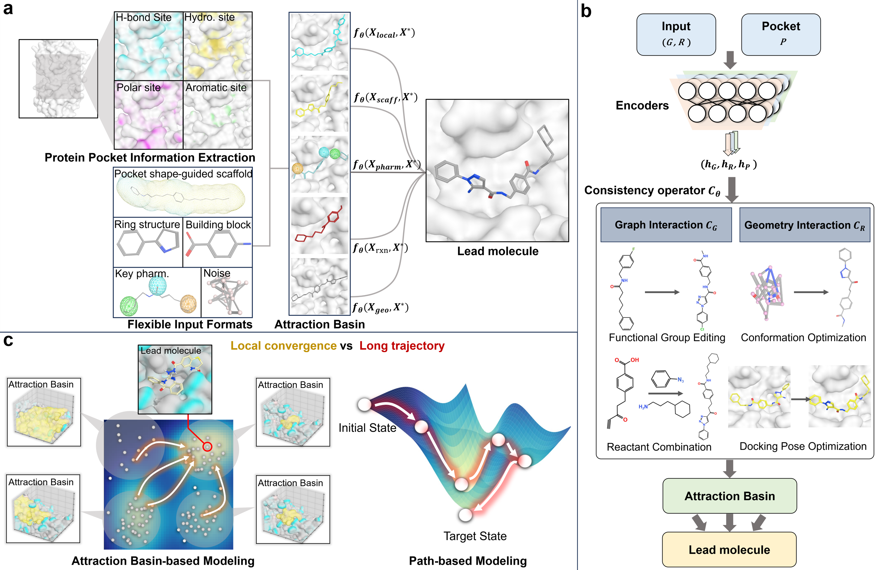

# ABCD — Attraction Basin Consistency Drug Design



ABCD learns pocket-conditioned mappings from groups of molecular intermediate states to a target molecule. The attraction basin combines local edits, scaffold retention, pharmacophore retention, reaction decomposition and geometry perturbations. The model predicts atom types, bonds and atom counts, then generates coordinates conditioned on the predicted graph.

## Project Structure

```text
dataset/                 Data preparation, state pools and mapping groups
model/                   Encoders, mapping operator and seed generation
utils/                   Chemistry, losses, distances and pocket scoring
eval/                    Generation ablations and molecular evaluation
configs/defaults.json    Model and evaluation parameters
config.py                Model and training configuration
mol_state.py             Molecular state representation
train.py                 Training entry point
generate_molecules.py    Generation entry point
```

## Installation

Use Python 3.11:

```bash
conda env create -f environment.yaml
conda activate abcd
```

The Conda environment includes [PLIP and Open Babel](https://github.com/pharmai/plip#installation) for interaction analysis and Vina, Meeko and gemmi for docking. Alternatively, install `requirements.txt` in an existing environment and add these tools as needed. Missing interactions are recorded with their actual fallback source. See [dataset/README.md](dataset/README.md) for data and fragment-database setup.

## Usage

### Training

Prepare the filename-based CrossDocked split, then train:

```bash
python -m dataset.prepare_crossdock \
  --output dataset/data/prepared/crossdock_train.json

python train.py --mode crossdock \
  --data-manifest dataset/data/prepared/crossdock_train.json \
  --mmp-db dataset/data/mmp.db --mmp-mode required --pocket-min 0.0 \
  --pool-cache-dir dataset/data/prepared/state_pools --epochs 150
```

`--pocket-min 0.0` is an execution example; select and validate this threshold for an experiment. Training runs in one process on the selected `--device`. `--batch-size` specifies the number of mapping groups per optimizer update. Model weights, configuration and metadata are saved after each completed epoch to `output/abcm.pt`; use `--output-dir` and `--checkpoint` to change the destination.


### Generation

With a reference ligand, mix minimum-scaffold states and conditional seeds:

```bash
python generate_molecules.py \
  --checkpoint output/abcm.pt \
  --pocket-pdb data/pocket.pdb --reference-sdf data/ref.sdf \
  --init-mode mixture --num-generate 16 --output-dir output/reference_generation
```

For pocket-only generation:

```bash
python generate_molecules.py \
  --checkpoint output/abcm.pt \
  --pocket-pdb data/pocket.pdb --init-mode seed \
  --num-generate 16 --output-dir output/seed_generation
```

Pretrained weights are not included. Generation requires a compatible trained checkpoint, such as `output/abcm.pt` saved by `train.py`. Replace `data/pocket.pdb` and `data/ref.sdf` with your input paths. References must contain a supplied 3D pose in the pocket coordinate frame. `pool` is a separate reference-conditioned mode. Use a fresh output directory for each run.

An explicit `--mmp-db` must be usable when constructing a state pool. Without it, optional backend fallbacks are recorded in the generation manifest.

`--num-generate` specifies attempts; failures are counted without replacement. Final SDFs and `generate_manifest.json` record chemistry, geometry, conditions and scoring errors. Chemical validity and geometry quality are reported separately, and raw coordinates are retained.

### Evaluation

For inference ablations, `eval/generate_molecules_ablation.py` accepts the generation arguments plus `--group-size`, `--group-context on|off` and pool-only `--exclude-state-types`. Loss ablations require separately trained checkpoints.

For one CSV with a `SMILES` or `smiles` column:

```bash
python eval/evaluate_diversity.py molecules.csv
```

This writes `molecules_diversity.json` with MACCS Bottleneck (the sum of nearest-neighbor distances, excluding self) and Morgan #Circles (a MaxMin approximation, not the proven maximum). Supply valid SMILES with at least two unique molecules. Defaults are Morgan radius 2, 2048 bits and distance threshold 0.75. Use `--smiles-column`, `--threshold`, `--seed` or `--output` as needed. Settings are in the `evaluation` section of [configs/defaults.json](configs/defaults.json). The two metrics use different fingerprints; comparisons require matching settings and molecule counts across models.

For SA, QED and a six-point Lipinski-like score:

```bash
python eval/evaluate_properties.py molecules.csv
```

SA uses the [RDKit SA score](https://github.com/rdkit/rdkit/blob/master/Contrib/SA_Score/sascorer.py), from 1 (easy) to 10 (difficult); [QED](https://www.rdkit.org/docs/source/rdkit.Chem.QED.html) ranges from 0 to 1. Lipinski awards one point for each of HBD ≤ 5, HBA ≤ 10, MW < 500, LogP ≤ 5, rotatable bonds ≤ 10 and TPSA ≤ 140. Rotatable bonds use RDKit's Strict definition.

For docking-based ligand efficiency against one CrossDocked receptor:

```bash
python -m pip install vina meeko gemmi
python eval/evaluate_le.py molecules.sdf --receptor pocket.pdb --reference-sdf reference.sdf
```

LE is `-Vina affinity / heavy-atom count`, averaged per molecule. [Vina redocking](https://autodock-vina.readthedocs.io/en/latest/docking_python.html) uses one fixed search box for all molecules. The optional reference ligand defines the box; otherwise it covers the supplied pocket. Use `--center` and `--box-size` for an explicit box. PDB receptors are prepared with Meeko; incomplete residues must be repaired, or supplied as a prepared rigid PDBQT. Ligands retain their supplied protonation state; SMILES inputs receive an ETKDGv3 conformer.

Both scripts accept a SMILES string, SMILES CSV, `.smi`/`.txt`, or SDF and write per-molecule CSV plus same-stem JSON means and sample SD. Use `--output results.csv` to set the destination. Supply valid molecules; duplicates are retained, and calculation errors stop execution. LE requires connected molecules and a valid receptor. Settings are under `evaluation.properties` and `evaluation.docking` in `configs/defaults.json`.

## Parameters and Implementation

| Setting | Default |
| --- | --- |
| Topology / scaffold / pharmacophore / shape distance weights | 0.25 each |
| Mapping distance bound / pairwise edit bound | 0.92 / 2 |
| Training group size | 3–6 |
| Joint state distance | `d_G + 5 d_R` |
| Target / basin / pocket / chemistry weights | 1 / 0.3 / 0.1 / 0.1 |
| Seed / initialization coefficients | 0.15 / 0.15 |
| Structural initialization probability | 0.5 |
| Initialization-group training attempt fraction | 0.25 |

Model defaults, loss weights, geometry thresholds and evaluation parameters are in [configs/defaults.json](configs/defaults.json). Training uses `config.py` and CLI arguments; evaluation reads the JSON `evaluation` section.

`d_G` uses a frozen, randomly initialized graph encoder with fixed chemical statistics; `d_R` uses atom-matched coordinate MSE. Atom, bond and count supervision belong to `L_chem`. Pocket clash penalties use all filtered heavy atoms in the supplied receptor file. Training groups satisfy chemistry, internal geometry, distance and edit constraints; initialization-group augmentation only admits the subset satisfying these constraints.

Reproduce a run using its saved checkpoint configuration and evaluation settings. Generated stereochemical, isotope and radical labels are not predicted. The Circles threshold is independent of the mapping bound. Reference-conditioned and pocket-only results should be reported separately.

## Contact

[11919015@zju.edu.cn](mailto:11919015@zju.edu.cn)

## License

The original source code in this repository is licensed under the [MIT License](LICENSE). Third-party dependencies and datasets remain subject to their respective licenses.
